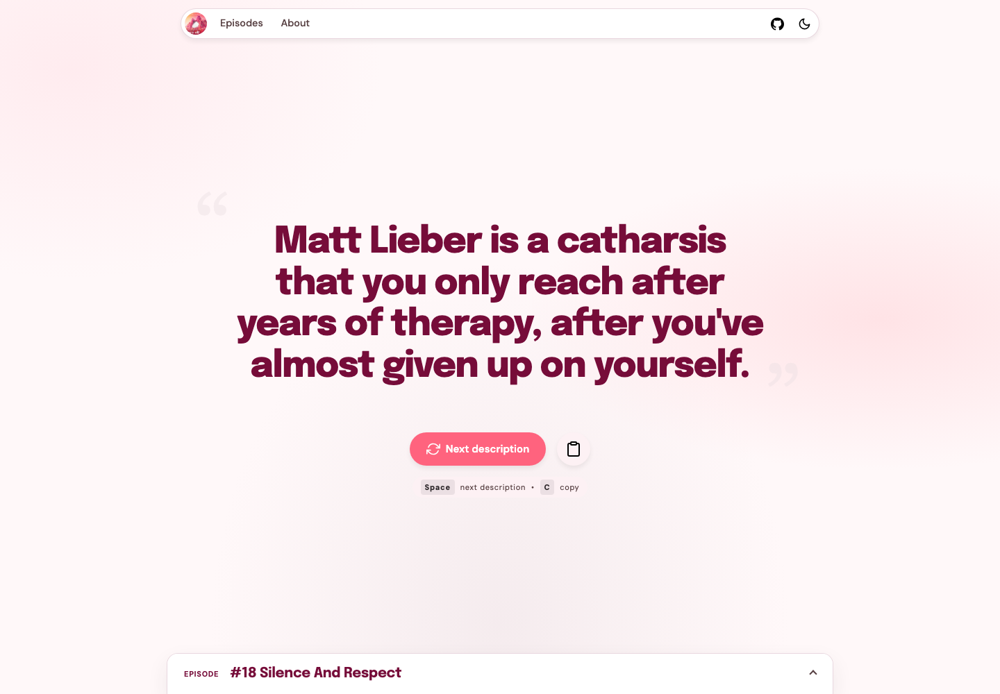
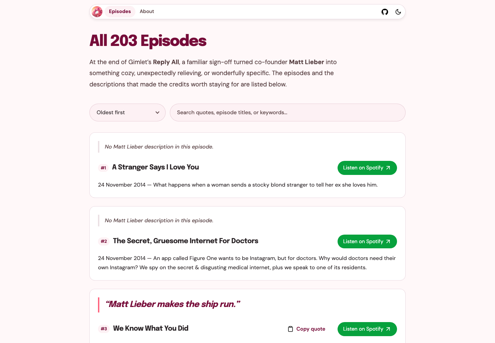
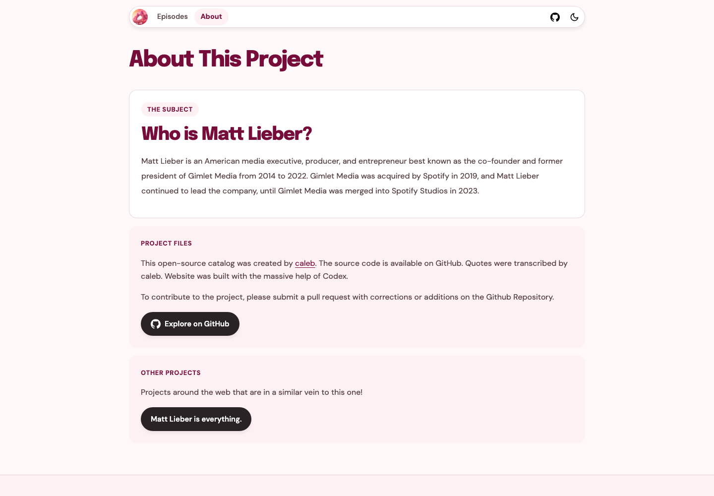

> [!note]
> This website has been reduced to a simple html and javascript website. Nothing crazy here, hoping this will make this project easier to build.

## Getting Started

Open the index.html file as a live preview in vscode to see your changes reflected in real time.

# Matt Lieber is…

This project is a compilation of all the affectionate, unexpected, and wonderfully specific descriptions of Matt Lieber from the end credits of the Reply All podcast by Gimlet Media. Reply All ran from 24 November 2014 till 23 June 2022.

[Visit the page.](https://calebnjw.github.io/mattlieberis/)

## Screenshots

### Home

### Episodes

### About

## Features

- A random Matt Lieber description on each visit, with a button to load another.
- Copy quotes with their episode attribution.
- Home-page keyboard shortcuts: **Space** for the next description and **C** to copy the current quote when focus is outside interactive controls.
- An expandable episode panel with a synopsis and a Spotify link when available.
- An episode archive with search across quotes, titles, synopses, and dates; sorting by oldest, newest, or shortest description; and a load-more button.
- Light and dark themes, with your choice saved in your browser when storage is available.
- Layouts for mobile and desktop, keyboard-accessible controls, and support for reduced-motion preferences.

## Getting Started

Open the index.html file as a live preview in vscode to see your changes reflected in real time.

## Project structure

| Location                                                 | Purpose                                                                  |
| -------------------------------------------------------- | ------------------------------------------------------------------------ |
| [index.html](./index.html)                               | Home-page entry point.                                                   |
| [episodes.html](./episodes.html)                         | Episode archive entry point.                                             |
| [about.html](./about.html)                               | About-page entry point.                                                  |
| [src/pages/](./src/pages/)                               | JavaScript for each page.                                                |
| [src/components/](./src/components/)                     | Shared navigation, footer, GitHub link, and theme toggle.                |
| [src/utils/episodeUtils.js](./src/utils/episodeUtils.js) | Loads episode data, selects random entries, and creates episode details. |
| [src/styles/styles.css](./src/styles/styles.css)         | Shared styles, responsive layouts, and themes.                           |
| [public/mattlieber.json](./public/mattlieber.json)       | Episode metadata and transcribed Matt Lieber descriptions.               |
| [public/](./public/)                                     | Images, icons, and other static assets.                                  |
| [docs/screenshots/](./docs/screenshots/)                 | Screenshots of the deployed Home, Episodes, and About pages.             |
| [stitch/matt-lieber-is/](./stitch/matt-lieber-is/)       | Design references, separate from the site’s page entry points.           |

## Contributing

Corrections, missing descriptions, and improvements to the site are welcome. [Open an issue](https://github.com/calebnjw/mattlieberis/issues) to flag a problem, or submit a pull request with a fix.

## Todos

1. ~~Current problem: Page is static. random number is generated once at build, and served to github pages:~~
   1. ~~Necessary Change 1: rewrite page to use useEffect to generate random number on each load.~~
   2. ~~Possible Option 1: store .json in local storage, and read from there.~~
   3. ~~Possible Option 2: create static pages of every single quote using generateStaticParams (which enables page linking from the all page).~~

2. ~~Another problem: IMAGES ARE NOT BEING REFERENCED CORRECTLY.~~
   1. ~~I need to figure out how to configure the basePath correctly. it's trying to fetch from /replyall.jpg rather than /mattlieberis/replyall.jpg despite "isProd" returning "true".~~

3. ~~Need to put the quote in the middle of the page.~~
4. ~~Make the accordion with description expand upwards.~~
5. ~~Make the about page one big accordion??? is that even good UX?~~
6. ~~Add the (scramble in)[https://www.fancycomponents.dev/docs/components/text/scramble-in] effect for the quote.~~ (irrelevant because I'm not using react anymore. could be done in plain JS though.)
7. ~~Add a github link in nav bar.~~
8. ~~Do up the about page!~~
   1. ~~About the podcast.~~
   2. ~~About why I created this project! Why though?~~

### Correcting or adding episode data

1. Find the episode in [public/mattlieber.json](./public/mattlieber.json). Entries live in the top-level `data` array.
2. Check the original episode audio. For a quote correction or addition, include the episode title, a listening link, and the timestamp in your issue or pull request.
3. Update the relevant fields using the conventions below. Preserve the wording of the spoken description.
4. Preview the site and check the changed entry in the episode archive, including search and its listening link. Keep the JSON valid, with no trailing commas.
5. Submit a pull request explaining what changed and how you verified it.

| Field                | Convention                                                                                                                                                           |
| -------------------- | -------------------------------------------------------------------------------------------------------------------------------------------------------------------- |
| `id`                 | Sequential integer starting at 1, in archive order. This is an internal ID, not necessarily the podcast episode number. Keep IDs sequential when inserting an entry. |
| `title`              | Episode title, including its published number where applicable, such as `#3 We Know What You Did`.                                                                   |
| `mattDescription`    | The words following “Matt Lieber”, such as `makes the ship run.` Do not repeat his name. Use `is not described.` for episodes with no description.                   |
| `episodeDescription` | The episode synopsis.                                                                                                                                                |
| `date`               | Publication date in the existing format, such as `03 December 2014`.                                                                                                 |
| `spotifyLink`        | The episode’s Spotify URL, or an empty string if unavailable.                                                                                                        |

For interface changes, check all three pages at mobile and desktop widths, try both themes, and test keyboard navigation. Quote copying needs a browser context that allows clipboard access, such as HTTPS or localhost.

## Sources, coverage, and credits

The current dataset contains **203 entries**, dated **24 November 2014 through 23 June 2022**, including numbered episodes and additional feed entries. Of these, **30 are marked as having no Matt Lieber description**, and **two have no Spotify link**. These counts describe the current dataset; corrections and missing entries are welcome.

Quotes were transcribed from the _Reply All_ podcast by [caleb](https://calebnjw.com). Each entry includes episode context and, where available, a Spotify link so you can listen to the source. Transcriptions may contain errors; please include audio evidence when suggesting a correction.

This project was created by caleb with substantial help from Codex. It is an _unofficial_ fan project and is not affiliated with or endorsed by Matt Lieber, Gimlet Media, or Spotify. Podcast quotes, episode synopses, names, and artwork are credited to their respective creators and rights holders.

## Deployment

The site can be hosted as static files. No build step, package installation, server-side application, or environment variables are required.

Publish [index.html](./index.html), [episodes.html](./episodes.html), [about.html](./about.html), [src/](./src/), and [public/](./public/) together, preserving their relative paths. The HTML files should be at the root of the published directory. The old Next.js build output and dependencies are not needed.

For GitHub Pages, check the repository’s **Settings → Pages** for the configured publishing branch or workflow before deploying. Publish the static files above from that source. After deployment, check all three pages, episode-data loading, images, theme switching, and quote copying on the hosted URL.

The publishing branch, workflow, and custom-domain configuration are not recorded here yet.

## License

No license has been specified for the project code yet. A code license should be added before describing the project as available under a particular open-source license.

Podcast quotations, episode synopses, and third-party artwork require separate attribution and are not automatically covered by any future code license.
